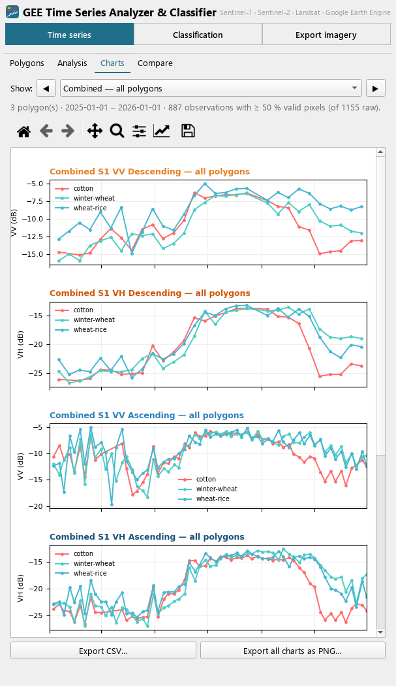
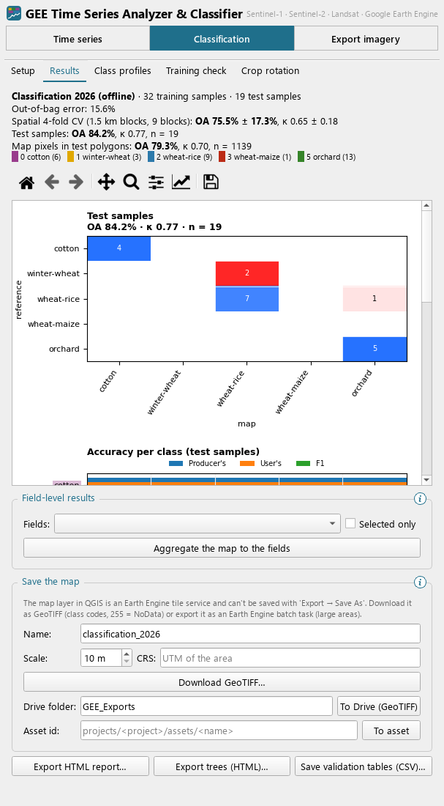
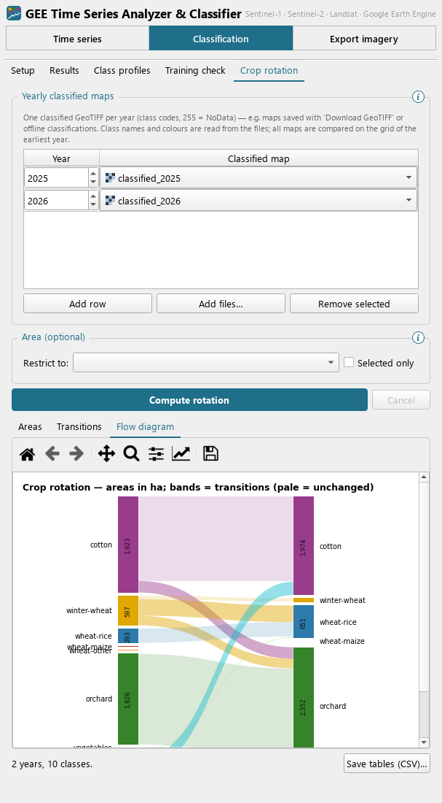
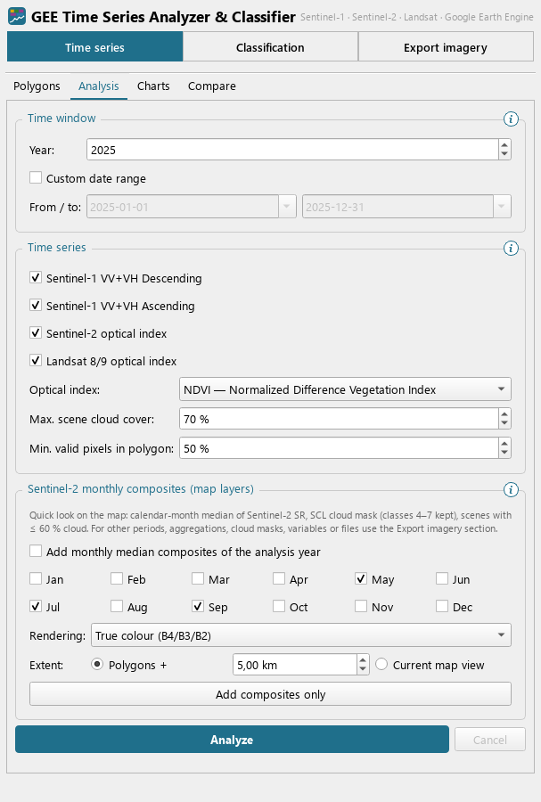
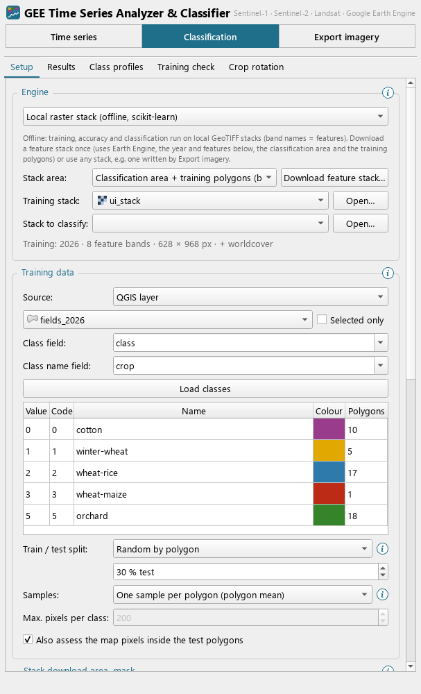
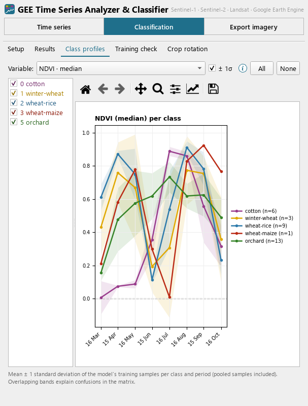
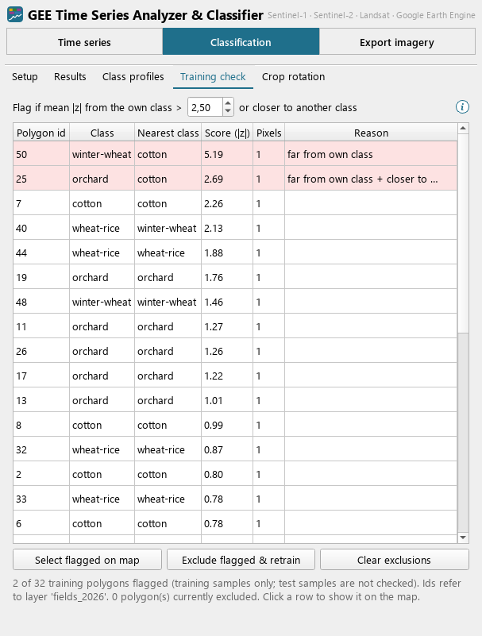
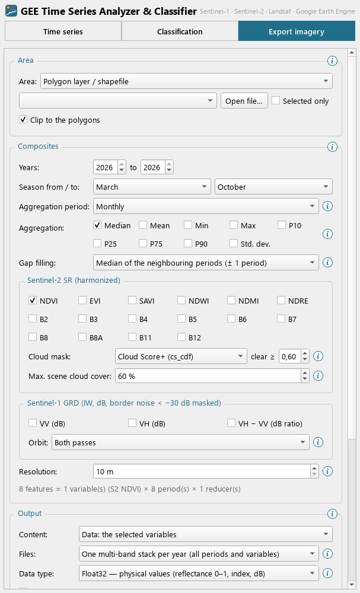
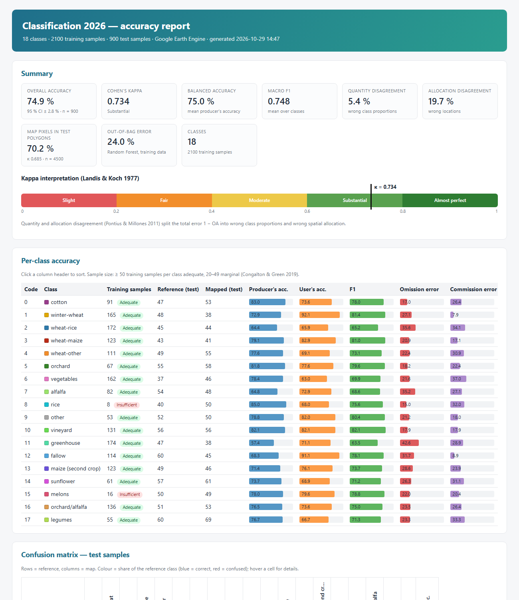
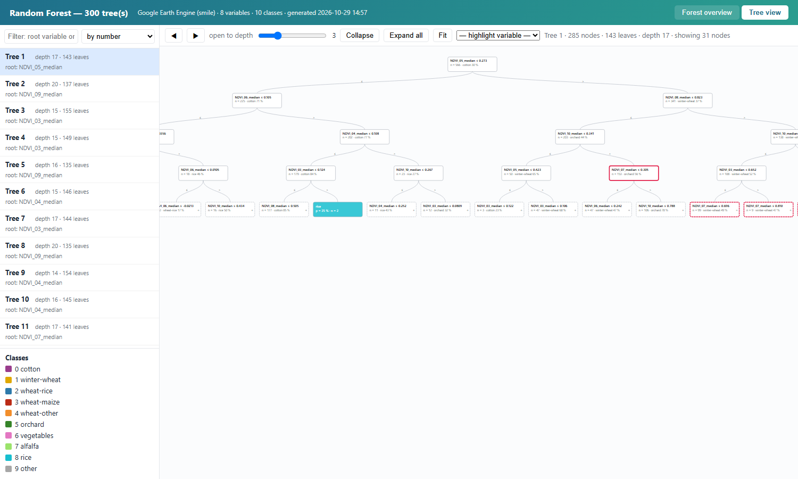

# GEE Time Series Analyzer & Classifier

**A QGIS plugin for satellite time series and crop classification with Google Earth Engine.**

The plugin works with polygons you draw, import or click on the map. It charts Sentinel-1, Sentinel-2 and Landsat time series for them, trains and validates crop classifiers (in Earth Engine or offline on your computer), and exports composites and time-series stacks as GeoTIFF. Everything runs inside the QGIS window, and the results are ordinary layers, files and reports.


<p align="center">
  
  
  
</p>

---

## Contents

- [Features](#features)
- [Screenshots](#screenshots)
- [Requirements](#requirements)
- [Installation](#installation)
- [Getting started](#getting-started)
- [Outputs and file formats](#outputs-and-file-formats)
- [Privacy and data](#privacy-and-data)
- [Limitations](#limitations)
- [Repository layout](#repository-layout)
- [License and attribution](#license-and-attribution)

## Features

The dock has three sections. Every group and the less obvious settings have an **ⓘ** button that explains them when you hover over it.

### Time series
- **Polygons** come from several sources: draw them on the map, import them from any layer or file (SHP, GPKG, GeoJSON, KML…), click fields of a layer (*Field Inspector*), or download a GEE table asset as a styled layer.
- **Time series** per polygon and date:
  - Sentinel-1 VV/VH backscatter (ascending and descending)
  - a Sentinel-2 optical index (NDVI, EVI, SAVI, NDWI or NDMI)
  - the same index from Landsat 8/9

  All polygons are reduced in a single Earth Engine request per product. Same-day acquisitions are merged, and the cloud threshold can be changed afterwards without a new request.
- **Charts**: all polygons combined, one chart per polygon, and a *Compare* view that ranks polygons by how much they deviate from the others. Clicking a line highlights its polygon on the map and vice versa.
- **Monthly Sentinel-2 composites** as map layers for a quick look.

### Classification
- **Two engines** with the same workflow:
  - **Google Earth Engine** (online)
  - **a local raster stack with scikit-learn** (offline). Download a feature stack once, or use any multi-band GeoTIFF.
- **Training data** from a QGIS layer or a GEE asset, with numeric or text classes. The test set is split off by an attribute or at random by polygon.
- **Features**:
  - season and aggregation period: dekads up to the whole season
  - aggregations: median, mean, min/max, percentiles, standard deviation
  - gap filling
  - Sentinel-2 indices and bands, with the Cloud Score+ or SCL cloud mask
  - Sentinel-1 VV/VH/ratio
- **Classifiers**: Random Forest, Gradient Tree Boost or CART.
- **Validation**:
  - confusion matrices and producer's/user's accuracy and F1 per class
  - OA with confidence interval, kappa, balanced accuracy, quantity/allocation disagreement
  - pixel-level accuracy of the map
  - **spatial k-fold cross-validation** (folds of spatial blocks)
- **Class profiles** (mean ± 1σ per class over the season) and a **training check** that flags likely mislabelled training fields. Flagged fields can be excluded with one click before retraining.
- **Models as JSON files**: apply a model to other years (its features are rebuilt and it is retrained from the stored samples), and pool the samples of several years for **multi-year training**.
- **Field-level results**: majority class per field, its share of the field (a confidence measure) and the runner-up class.
- **Reports**:
  - a self-contained **HTML accuracy report**
  - an interactive **HTML viewer of all Random Forest trees**
  - CSV tables
- **Crop rotation**: class areas per year, transition matrices, a flow diagram and a change map from yearly maps.

### Export imagery
- Composites and time-series stacks for a polygon layer, a rectangle drawn on the map or the map view. You can export one stack per year, one file per period or one file per variable, as Float32 or as scaled Int16.
- Every file carries band names, metadata for each band (variable, period, dates, aggregation) and a JSON file with all settings. Every data file can be used directly as a stack for the offline classification.
- Download directly (tile by tile), or start Earth Engine batch exports to Google Drive.

### Processing Toolbox
The following algorithms work in batch mode and in the Model Builder:
- extract polygon time series
- download a GEE table asset
- **apply a classification model** to a year (Earth Engine) or to a local stack
- **aggregate a classified map to fields**
- **crop transition matrix**

## Screenshots

| | |
|---|---|
|  |  |
| *Time series: time window, products and cloud thresholds* | *Classification setup (offline engine with a local stack)* |
|  |  |
| *Class profiles of the training samples* | *Training check: likely mislabelled fields* |
|  |  |
| *Export imagery with the full composite settings* | *Crop rotation between two years* |

<p align="center">
  <br>
  <em>HTML accuracy report (here with 18 classes)</em>
</p>
<p align="center">
  <br>
  <em>Interactive viewer of all Random Forest trees: forest overview, zoomable trees, nodes open on click</em>
</p>

## Requirements

- **QGIS 3.22 or newer** (tested with QGIS 3.40 LTR on Windows).
- **[Google Earth Engine plugin](https://plugins.qgis.org/plugins/ee_plugin/)** for QGIS. It provides `earthengine-api` and the sign-in. You also need an Earth Engine account and a Cloud project with the Earth Engine API enabled. Non-commercial use is free after registration.
- `pandas` and `matplotlib`, which are bundled with QGIS on Windows.
- Optional, only for the **offline classification**: `scikit-learn`. To install it, run this in the OSGeo4W Shell:
  ```
  python -m pip install scikit-learn
  ```

## Installation

**From a release (recommended)**
1. Download `gee_timeseries_analyzer.zip` from the [Releases](../../releases) page.
2. In QGIS, go to *Plugins → Manage and Install Plugins → Install from ZIP* and choose the file.
3. Enable **GEE Time Series Analyzer & Classifier** and click its toolbar icon.

**From source**
```
git clone <this repository>
python scripts/build_plugin_zip.py      # writes dist/gee_timeseries_analyzer.zip
```
Install the ZIP as above. Alternatively, copy `qgis_plugin/gee_timeseries_analyzer` into your QGIS profile's `python/plugins` folder.

## Getting started

Sign in once through the **Google Earth Engine** plugin. This plugin then uses that sign-in and Cloud project automatically; you can also enter a different project under *Time series → Polygons → Earth Engine*.

**Time series of a few fields**
1. *Time series → Polygons*: draw polygons, or *Open file…* to import a shapefile.
2. *Analysis*: choose the year and products, then click **Analyze**.
3. *Charts* and *Compare* fill in. Save the results with *Export CSV* or *PNG*.

**Inspecting many fields one by one**
1. Load a field layer, or a GEE asset via *Download asset as layer*.
2. Activate *Click a field on the map*. Each click computes that field's time series; fields you have already clicked come from the cache.

**Crop classification in Earth Engine**
1. *Classification → Setup*: choose the training layer and class field, then *Load classes*. Set the split, classification area, features and classifier.
2. Click **Train & classify**. The map appears as a layer, and *Results* shows the accuracy.
3. Optionally: *Export HTML report*, *Export trees*, *Aggregate the map to the fields*, *Download GeoTIFF*, and **Save model…**

**Offline classification**
1. Under *Engine*, choose *Local raster stack*. Then either *Download feature stack…* (this step uses Earth Engine once) or open an existing stack.
2. Click **Train & classify stack**. Training, accuracy assessment and the map run on your computer.

**Other years and several years**
- *Load model… → Apply to year* applies a saved model to another year, online or on a stack of that year.
- *Pool samples from models…* adds the samples of other years to the next training run.
- *Crop rotation*: add the yearly maps, then **Compute rotation**.

**Composites and stacks**
- *Export imagery*: choose the area, years, period, aggregation, variables and cloud mask, and the output format. Read the summary, then click **Download GeoTIFFs**.

A detailed description of every option is in the [plugin README](qgis_plugin/gee_timeseries_analyzer/README.md).

## Outputs and file formats

| Output | Format | Notes |
|---|---|---|
| Time series | CSV | polygon, series, date, value, valid fraction |
| Classified map | GeoTIFF (Byte) | class codes, 255 = NoData, colour table; class names in the `.aux.xml` file next to it |
| Feature / composite stacks | GeoTIFF (Float32 or scaled Int16) + `.json` | band names like `NDVI_05_median`, band metadata, full settings |
| Model | JSON | feature settings, classifier settings, classes and colours, training samples |
| Accuracy report | HTML (self-contained) | opens in any browser, no internet needed |
| Tree viewer | HTML (self-contained) | all trees of a Random Forest / CART model |
| Field results | vector layer | `cls_code`, `cls_name`, `cls_share`, `cls2_*`, `n_pixels` |
| Rotation | CSV, PNG, GeoTIFF | areas, transitions, flow diagram, change map |

## Privacy and data

- **No telemetry.** The plugin sends no usage data anywhere.
- **Earth Engine:** polygons, training samples and requests are sent to Google Earth Engine under **your own** account and Cloud project; [Google's terms](https://earthengine.google.com/terms/) apply. The offline engine needs no connection after the stack download.
- **Local files:** downloaded assets are cached as GeoJSON in your QGIS profile folder. Everything else is written only where you choose.
- **What files contain:**
  - **Model files** contain the training samples (feature values and classes, no geometries) and the name of the training layer or asset ID.
  - **HTML reports** contain file names but no local folder paths.
  - **Exported stacks** contain their full settings.

  Check these files before you share them, if any of this is sensitive.

## Limitations

- Sentinel-2 surface reflectance is available from March 2017, and Landsat 9 from late 2021.
- Interactive Earth Engine requests (sampling, direct downloads) are subject to Earth Engine's limits. Use the batch exports to Drive for very large areas, and a GEE asset (rather than a QGIS layer) for thousands of training polygons.
- Gradient boosting trees can't be shown in the tree viewer. Earth Engine's and scikit-learn's Random Forests are different implementations, so the same samples give slightly different models.

## Repository layout

```
qgis_plugin/gee_timeseries_analyzer/   the plugin (Python sources, icon, metadata, detailed README)
scripts/build_plugin_zip.py           builds dist/gee_timeseries_analyzer.zip
docs/images/                          screenshots for this page
```

## License and attribution

The plugin is free software under the **GNU General Public License v2.0 or later** ([LICENSE](LICENSE)).

**Data:**
- Copernicus Sentinel-1 and Sentinel-2 data (ESA)
- Landsat 8/9 Collection 2 (USGS)
- ESA WorldCover 2021 (© ESA WorldCover project, CC BY 4.0)
- Cloud Score+ (Google)

All data is accessed through Google Earth Engine.

**Methods referenced in the reports:**
- Congalton & Green (2019)
- Landis & Koch (1977)
- Pontius & Millones (2011)
- Olofsson et al. (2014)

Bug reports and suggestions are welcome as [issues](../../issues).
